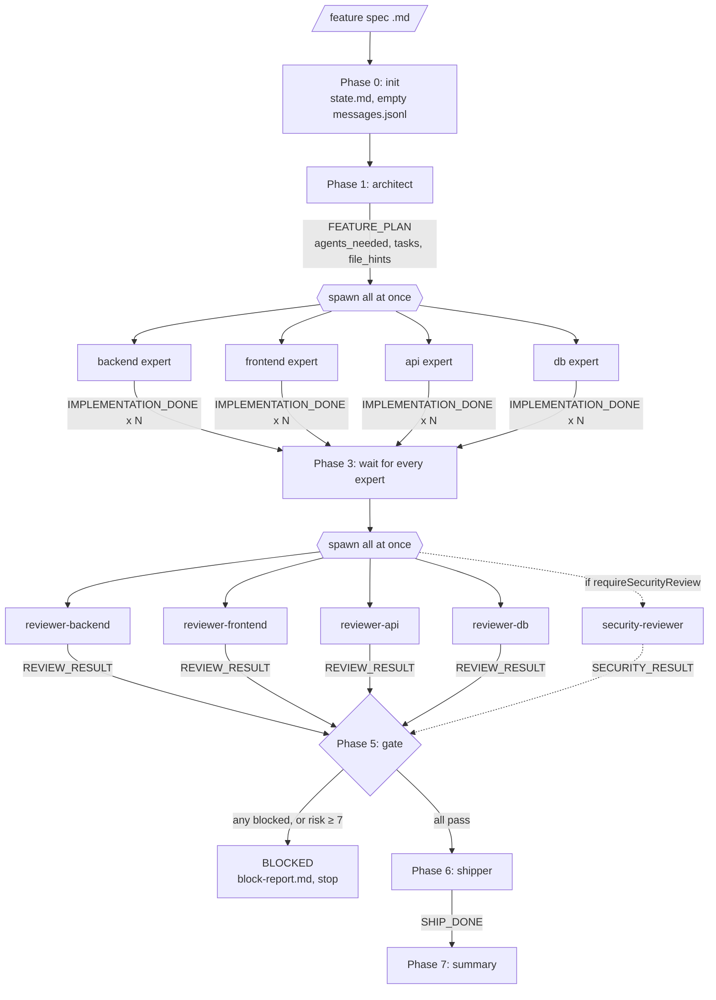

# Architecture

Vulcan turns a feature spec into a pull request with a fixed crew of Claude Code
agents. A **Vulcan Orchestrator** session follows the protocol in
[`CLAUDE.md`](../CLAUDE.md): one Architect plans, domain experts build in
parallel, reviewers gate in parallel, and a Shipper lands the change only if the
gate passes. Every hand-off is a typed JSON message appended to an audit log.

There is no application code: the system is the protocol, the role prompts and
the validators that keep them consistent.

## Layers

| Layer | Files | Responsibility |
|---|---|---|
| Entry point | `skills/vulcan.md` | `/vulcan <spec>`: parse flags, build the session config, hand off to the protocol |
| Orchestration | `CLAUDE.md` | Phases 0–7, spawn rules, gate conditions, message protocol, invariants |
| Roles | `agents/*.md` | One prompt per role; frontmatter declares `phase` and emitted message types |
| Input format | `templates/feature.md` | Feature spec: frontmatter (slug, stack, `skip_agents`, security flag) + success criteria |
| Validators | `scripts/*.sh`, `scripts/*.mjs` | Index completeness, definition/spec frontmatter, audit-trail conformance |
| Reference run | `examples/conductor-phase1-run/` | A real session's spec, plan, reviews, state and `messages.jsonl` |
| Runtime | `workspace/` (git-ignored) | Per-session state, plans, reviews, audit log |

## Roles

| Agent | Phase | Spawned as | Emits | Writes to `workspace/` |
|---|---|---|---|---|
| architect | 1 | `architect` | `FEATURE_PLAN` | `plan.md` |
| backend, frontend, api, db | 2 (parallel) | `{agent}-expert` | `IMPLEMENTATION_DONE` | `api-contract.md` (api), `schema-diff.md` (db); code goes to the target project |
| reviewer | 4 (parallel, one per expert) | `reviewer-{agent}` | `REVIEW_RESULT` | `review-{agent}.md` |
| security | 4 (parallel, optional) | `security-reviewer` | `SECURITY_RESULT` | `review-security.md` |
| shipper | 6 | `shipper` | `SHIP_DONE` | git branch, commit, push, PR in the target project |

The orchestrator itself never edits the target project; it only writes
`workspace/state.md`, `workspace/messages.jsonl` and, on a block,
`workspace/block-report.md`.

## Pipeline

Phases 2 and 4 are strictly parallel: the orchestrator spawns every expert (then
every reviewer) before waiting on any of them. `agents_needed` in
`FEATURE_PLAN`, minus `skipAgents` from the config and `skip_agents` from the
spec, is the authoritative list of experts and of reviewers.

## Messages

All messages carry `type`, `session` and `feature`, and are appended, one JSON
object per line, to `workspace/messages.jsonl`. The log is never rewritten.

| Message | From → To | Key fields | Used for |
|---|---|---|---|
| `FEATURE_PLAN` | architect → orchestrator | `agents_needed`, `tasks{agent}`, `file_hints{agent}`, `api_contract`, `data_model`, `risk_flags` | Decides which experts run and what each one gets |
| `IMPLEMENTATION_DONE` | expert → orchestrator | `agent`, `files_created`, `files_modified`, `self_assessment` (`pass`/`warn`/`fail`) | Forwarded verbatim to that expert's reviewer; file lists feed the security scan and the shipper |
| `REVIEW_RESULT` | reviewer → orchestrator | `reviewer_for`, `verdict`, `issues[]` (severity, file, required_fix), `criteria_met[]` | Gate input |
| `SECURITY_RESULT` | security → orchestrator | `verdict`, `risk_score` 0–10, `findings[]` (CWE) | Gate input |
| `SHIP_DONE` | shipper → orchestrator | `branch`, `commit_sha`, `pr_url` (nullable) | Final summary |

The exact example for each type is in `CLAUDE.md` under *Message Protocol*;
the validators parse it from there rather than keeping a second copy.

## Gates

**Phase 5 is the only path to Phase 6.** The ship is blocked if any of:

- a `REVIEW_RESULT` has `verdict: "blocked"`. Reviewers block on any critical
  or major issue, or any unmet success criterion; minor issues give
  `approved_with_notes`, which ships.
- a `SECURITY_RESULT` has `verdict: "blocked"`.
- a `SECURITY_RESULT` has `risk_score >= 7` (the security agent also blocks on
  any critical finding regardless of score).

An expert reporting `self_assessment: "fail"` does not stop the run; its row is
flagged `⚠ FAIL` in `state.md` and its reviewer makes the call.

The shipper stages only the files listed in the experts' `IMPLEMENTATION_DONE`
messages (never `git add -A`, never workspace files, never `--force`).

## Failure handling

| Situation | What happens |
|---|---|
| Gate blocks | `state.md` → `BLOCKED`; `block-report.md` lists blocking issues and required fixes; nothing is committed. Re-run with `--skip-agents <passed experts>` after fixing |
| Expert self-reports `fail` | Recorded, not fatal; the reviewer decides |
| PR creation fails after a successful push | Shipper still sends `SHIP_DONE` with `pr_url: null`; a push is a ship |
| Branch already exists | Shipper checks it out instead of failing |
| Incomplete spec or agent thrash | Operator stops, fixes the spec, resets `workspace/` ([OPERATOR.md](OPERATOR.md)) |
| Audit trail looks wrong | `node scripts/validate-messages.mjs workspace/messages.jsonl` reports which invariant broke |

## Invariants checked in CI

`npm run check` (also run by `.github/workflows/validate-index.yml`) enforces:

1. **Index:** every file in `agents/` and `skills/` is listed by path in `docs/INDEX.md`.
2. **Definitions:** every agent has `name`, `kind`, `description`, `phase` and
   `emits`; every emitted type exists in `CLAUDE.md` and appears in that agent's
   output contract; every protocol type has an emitter; every `agents/*.md`
   path that `CLAUDE.md` references exists; the four experts are phase 2.
3. **Feature specs:** required frontmatter, valid `status` / `priority`, known
   `stack` domains and `skip_agents`, no machine-specific `target_dir`.
4. **Audit trail** (`validate-messages.mjs`, run on the sample and usable on
   any `workspace/messages.jsonl`): schema per type, enums, one session,
   `FEATURE_PLAN` first, only assigned agents report or get reviewed, every
   expert reports before review starts, and `SHIP_DONE` appears only after every
   expert was reviewed and the gate passed.
